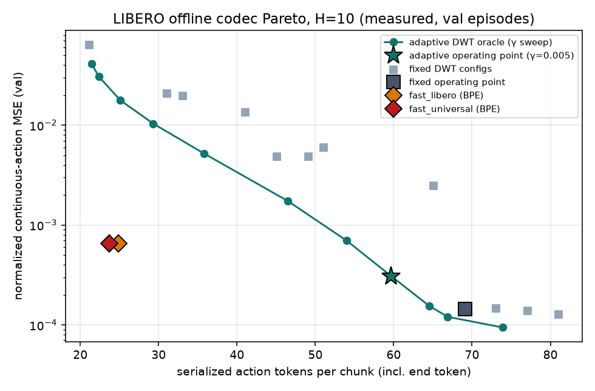
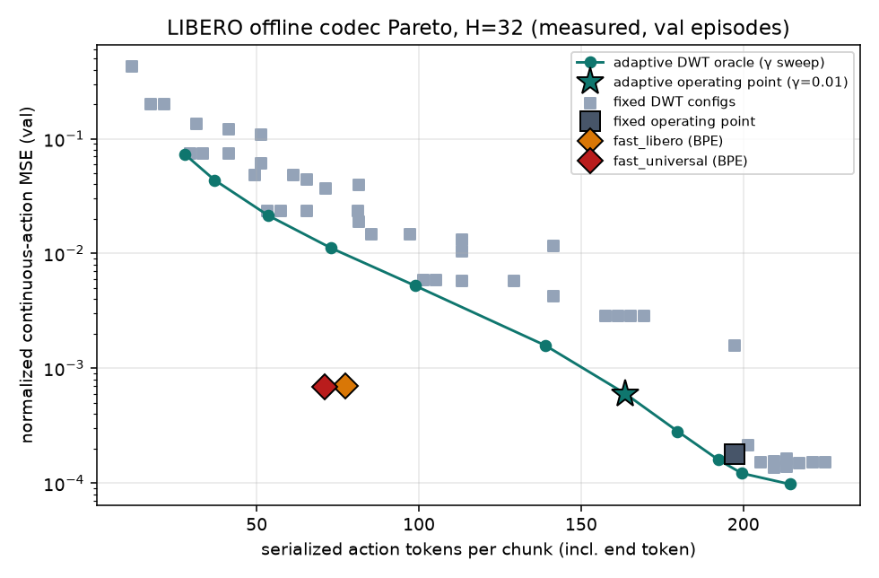

# Stage A: offline codec report (measured)

All numbers are **measured** on held-out validation episodes of `lerobot/libero` (revision a1aaacb7), disjoint windows (stride = H), actions normalized with MEAN_STD statistics of the training split of all 40 tasks. Hyper-parameters (γ, fixed plan) were chosen on training windows only. Token counts include the end token (`|` for FAST, `<A_END>` for DWT); the shared `Action: ` prefix is not counted. Produced by `scripts/evaluate_codec.py`; this file by `scripts/write_reports.py`.

## H = 10  (2674 validation windows, segment lengths [2, 4, 8])

Selection rule: largest gamma whose train-window MSE <= FAST(libero) train MSE; fixed = fewest tokens with train MSE <= adaptive. Chosen γ = **0.005**, fixed plan = **[[8, 3], [2, 1]]**.

| method | config | tokens mean | p95 | max | MSE | max abs err | vel MSE | jerk MSE | MSE near gripper event | gripper exact | entropy bits/chunk | clip rate |
|---|---|---|---|---|---|---|---|---|---|---|---|---|
| fast_libero | scale=10.0,bpe_vocab=1024 | 24.9 | 37 | 48 | 6.51e-04 | 0.118 | 1.10e-03 | 9.56e-03 | 7.08e-04 | 1.000 | 204.9 | – |
| fast_universal | scale=10,bpe_vocab=2048 | 23.7 | 34 | 43 | 6.51e-04 | 0.118 | 1.10e-03 | 9.56e-03 | 7.08e-04 | 1.000 | 205.5 | – |
| dwt_adaptive_oracle | gamma=0.0 | 73.9 | 81 | 82 | 9.40e-05 | 0.468 | 6.86e-05 | 5.43e-04 | 8.54e-05 | 1.000 | 432.8 | 2.49e-05 |
| dwt_adaptive_oracle | gamma=0.001 | 66.9 | 73 | 75 | 1.20e-04 | 0.490 | 8.91e-05 | 7.51e-04 | 1.02e-04 | 1.000 | 390.0 | 2.61e-05 |
| dwt_adaptive_oracle | gamma=0.002 | 64.5 | 70 | 75 | 1.55e-04 | 0.490 | 1.56e-04 | 1.39e-03 | 1.22e-04 | 1.000 | 381.1 | 2.72e-05 |
| dwt_adaptive_oracle | **gamma=0.005 (chosen)** | 59.7 | 69 | 70 | 3.07e-04 | 0.490 | 5.17e-04 | 5.14e-03 | 2.09e-04 | 1.000 | 361.5 | 3.01e-05 |
| dwt_adaptive_oracle | gamma=0.01 | 54.0 | 69 | 70 | 6.97e-04 | 0.490 | 1.43e-03 | 0.015 | 4.82e-04 | 1.000 | 335.3 | 3.42e-05 |
| dwt_adaptive_oracle | gamma=0.02 | 46.5 | 69 | 70 | 1.74e-03 | 0.490 | 3.85e-03 | 0.042 | 1.36e-03 | 1.000 | 295.4 | 3.12e-05 |
| dwt_adaptive_oracle | gamma=0.05 | 35.8 | 63 | 70 | 5.21e-03 | 0.707 | 0.011 | 0.122 | 4.96e-03 | 1.000 | 231.5 | 4.44e-05 |
| dwt_adaptive_oracle | gamma=0.1 | 29.3 | 49 | 64 | 0.010 | 1.009 | 0.020 | 0.202 | 0.012 | 1.000 | 189.0 | 5.83e-05 |
| dwt_adaptive_oracle | gamma=0.2 | 25.1 | 37 | 64 | 0.018 | 1.145 | 0.028 | 0.262 | 0.022 | 1.000 | 159.9 | 4.81e-05 |
| dwt_adaptive_oracle | gamma=0.5 | 22.4 | 27 | 47 | 0.031 | 1.756 | 0.036 | 0.293 | 0.042 | 1.000 | 139.8 | 5.68e-05 |
| dwt_adaptive_oracle | gamma=1.0 | 21.4 | 27 | 37 | 0.041 | 2.332 | 0.040 | 0.291 | 0.059 | 1.000 | 132.3 | 3.03e-05 |
| dwt_fixed | [(8, 0), (2, 0)] | 21.1 | 22 | 22 | 0.064 | 3.220 | 0.042 | 0.233 | 0.089 | 1.000 | 129.2 | 6.23e-05 |
| dwt_fixed | [(8, 1), (2, 1)] | 33.1 | 34 | 34 | 0.020 | 1.861 | 0.033 | 0.272 | 0.032 | 1.000 | 203.1 | 3.12e-05 |
| dwt_fixed | [(8, 2), (2, 1)] | 45.1 | 46 | 46 | 4.83e-03 | 0.986 | 0.017 | 0.251 | 7.97e-03 | 1.000 | 272.6 | 2.08e-05 |
| dwt_fixed | **[(8, 3), (2, 1)] (chosen)** | 69.1 | 70 | 70 | 1.45e-04 | 0.541 | 6.98e-05 | 5.51e-04 | 1.30e-04 | 1.000 | 392.4 | 1.87e-05 |
| dwt_fixed | [(4, 0), (2, 0), (2, 0), (2, 0)] | 41.1 | 42 | 42 | 0.013 | 1.560 | 0.026 | 0.285 | 0.021 | 1.000 | 248.6 | 4.67e-05 |
| dwt_fixed | [(4, 1), (2, 1), (2, 1), (2, 1)] | 65.1 | 66 | 66 | 2.46e-03 | 0.868 | 7.80e-03 | 0.091 | 3.52e-03 | 1.000 | 387.8 | 3.12e-05 |
| dwt_fixed | [(4, 2), (2, 1), (2, 1), (2, 1)] | 77.1 | 78 | 78 | 1.37e-04 | 0.582 | 9.45e-05 | 7.20e-04 | 1.24e-04 | 1.000 | 453.9 | 2.49e-05 |
| dwt_fixed | [(4, 0), (4, 0), (2, 0)] | 31.1 | 32 | 32 | 0.021 | 1.848 | 0.038 | 0.312 | 0.035 | 1.000 | 189.3 | 6.23e-05 |
| dwt_fixed | [(4, 1), (4, 1), (2, 1)] | 49.1 | 50 | 50 | 4.84e-03 | 0.999 | 0.017 | 0.252 | 7.99e-03 | 1.000 | 296.4 | 3.12e-05 |
| dwt_fixed | [(4, 2), (4, 2), (2, 1)] | 73.1 | 74 | 74 | 1.46e-04 | 0.582 | 8.63e-05 | 6.75e-04 | 1.33e-04 | 1.000 | 423.3 | 2.49e-05 |
| dwt_fixed | [(2, 0), (2, 0), (2, 0), (2, 0), (2, 0)] | 51.1 | 52 | 52 | 6.00e-03 | 0.990 | 0.021 | 0.283 | 0.011 | 1.000 | 303.9 | 4.99e-05 |
| dwt_fixed | [(2, 1), (2, 1), (2, 1), (2, 1), (2, 1)] | 81.1 | 82 | 82 | 1.27e-04 | 0.468 | 9.73e-05 | 7.10e-04 | 1.16e-04 | 1.000 | 474.7 | 3.12e-05 |

Example stream with grammar trace: [`example_stream_H10.txt`](example_stream_H10.txt); trajectory: 

Operating points (validation):

|  | tokens | MSE | max abs | vel MSE |
|---|---|---|---|---|
| FAST (libero BPE) | 24.9 | 6.51e-04 | 0.118 | 1.10e-03 |
| adaptive DWT γ=0.005 | 59.7 | 3.07e-04 | 0.490 | 5.17e-04 |
| fixed DWT [[8, 3], [2, 1]] | 69.1 | 1.45e-04 | 0.541 | 6.98e-05 |

## H = 32  (783 validation windows, segment lengths [4, 8, 16, 32])

> **Note:** only 783 disjoint H=32 windows exist in the validation episodes, fewer than the spec's 1000. Overlapping windows would inflate the count without adding independent data.

Selection rule: largest gamma whose train-window MSE <= FAST(libero) train MSE; fixed = fewest tokens with train MSE <= adaptive. Chosen γ = **0.01**, fixed plan = **[[32, 5]]**.

| method | config | tokens mean | p95 | max | MSE | max abs err | vel MSE | jerk MSE | MSE near gripper event | gripper exact | entropy bits/chunk | clip rate |
|---|---|---|---|---|---|---|---|---|---|---|---|---|
| fast_libero | scale=10.0,bpe_vocab=1024 | 77.4 | 107 | 120 | 6.98e-04 | 0.194 | 1.20e-03 | 0.011 | 7.20e-04 | 1.000 | 635.3 | – |
| fast_universal | scale=10,bpe_vocab=2048 | 70.8 | 97 | 109 | 6.93e-04 | 0.158 | 1.20e-03 | 0.011 | 7.10e-04 | 1.000 | 625.9 | – |
| dwt_adaptive_oracle | gamma=0.0 | 214.3 | 222 | 226 | 9.77e-05 | 0.169 | 6.53e-05 | 5.00e-04 | 9.72e-05 | 1.000 | 1195.5 | 6.65e-06 |
| dwt_adaptive_oracle | gamma=0.001 | 199.5 | 210 | 217 | 1.22e-04 | 0.169 | 7.94e-05 | 6.63e-04 | 1.14e-04 | 1.000 | 1105.8 | 6.86e-06 |
| dwt_adaptive_oracle | gamma=0.002 | 192.3 | 205 | 210 | 1.59e-04 | 0.169 | 1.18e-04 | 1.08e-03 | 1.44e-04 | 1.000 | 1068.6 | 7.03e-06 |
| dwt_adaptive_oracle | gamma=0.005 | 179.7 | 198 | 202 | 2.82e-04 | 0.199 | 3.81e-04 | 4.07e-03 | 2.13e-04 | 1.000 | 1025.8 | 1.52e-05 |
| dwt_adaptive_oracle | **gamma=0.01 (chosen)** | 163.6 | 198 | 199 | 5.99e-04 | 0.315 | 1.17e-03 | 0.014 | 4.50e-04 | 1.000 | 963.8 | 1.70e-05 |
| dwt_adaptive_oracle | gamma=0.02 | 139.0 | 198 | 199 | 1.58e-03 | 0.466 | 3.51e-03 | 0.041 | 1.28e-03 | 1.000 | 850.9 | 2.07e-05 |
| dwt_adaptive_oracle | gamma=0.05 | 98.8 | 160 | 198 | 5.25e-03 | 0.689 | 0.012 | 0.133 | 5.47e-03 | 1.000 | 633.8 | 4.62e-05 |
| dwt_adaptive_oracle | gamma=0.1 | 73.0 | 114 | 169 | 0.011 | 0.968 | 0.022 | 0.222 | 0.013 | 1.000 | 481.7 | 6.52e-05 |
| dwt_adaptive_oracle | gamma=0.2 | 53.6 | 88 | 131 | 0.021 | 1.182 | 0.033 | 0.290 | 0.025 | 1.000 | 360.4 | 9.26e-05 |
| dwt_adaptive_oracle | gamma=0.5 | 37.0 | 54 | 89 | 0.044 | 1.873 | 0.046 | 0.335 | 0.056 | 1.000 | 252.5 | 1.37e-04 |
| dwt_adaptive_oracle | gamma=1.0 | 27.8 | 45 | 65 | 0.073 | 2.732 | 0.051 | 0.334 | 0.094 | 1.000 | 190.8 | 6.17e-05 |
| dwt_fixed | [(16, 0), (8, 0), (8, 0)] | 31.4 | 32 | 33 | 0.135 | 3.756 | 0.052 | 0.290 | 0.147 | 1.000 | 196.2 | 1.42e-04 |
| dwt_fixed | [(16, 1), (8, 1), (8, 1)] | 49.4 | 50 | 51 | 0.048 | 3.224 | 0.048 | 0.330 | 0.061 | 1.000 | 317.0 | 7.10e-05 |
| dwt_fixed | [(16, 2), (8, 2), (8, 2)] | 85.4 | 86 | 87 | 0.015 | 1.813 | 0.030 | 0.294 | 0.019 | 1.000 | 523.8 | 3.55e-05 |
| dwt_fixed | [(16, 3), (8, 3), (8, 3)] | 157.4 | 158 | 159 | 2.87e-03 | 0.878 | 9.42e-03 | 0.128 | 2.86e-03 | 1.000 | 886.0 | 2.66e-05 |
| dwt_fixed | [(16, 4), (8, 3), (8, 3)] | 205.4 | 206 | 207 | 1.51e-04 | 0.306 | 6.71e-05 | 5.12e-04 | 1.42e-04 | 1.000 | 1114.5 | 2.00e-05 |
| dwt_fixed | [(8, 0), (8, 0), (8, 0), (8, 0)] | 41.3 | 42 | 43 | 0.074 | 3.204 | 0.056 | 0.343 | 0.102 | 1.000 | 253.3 | 1.06e-04 |
| dwt_fixed | [(8, 1), (8, 1), (8, 1), (8, 1)] | 65.3 | 66 | 67 | 0.023 | 1.953 | 0.042 | 0.320 | 0.037 | 1.000 | 409.7 | 5.32e-05 |
| dwt_fixed | [(8, 2), (8, 2), (8, 2), (8, 2)] | 113.3 | 114 | 115 | 5.78e-03 | 0.986 | 0.020 | 0.268 | 9.20e-03 | 1.000 | 675.4 | 2.66e-05 |
| dwt_fixed | [(8, 3), (8, 3), (8, 3), (8, 3)] | 209.3 | 210 | 211 | 1.37e-04 | 0.306 | 6.80e-05 | 5.18e-04 | 1.29e-04 | 1.000 | 1140.7 | 2.00e-05 |
| dwt_fixed | [(16, 0), (16, 0)] | 21.4 | 22 | 23 | 0.199 | 3.756 | 0.047 | 0.223 | 0.235 | 1.000 | 131.9 | 1.06e-04 |
| dwt_fixed | [(16, 1), (16, 1)] | 33.4 | 34 | 35 | 0.074 | 3.224 | 0.056 | 0.343 | 0.102 | 1.000 | 216.4 | 5.32e-05 |
| dwt_fixed | [(16, 2), (16, 2)] | 57.4 | 58 | 59 | 0.024 | 1.934 | 0.042 | 0.320 | 0.037 | 1.000 | 363.2 | 2.66e-05 |
| dwt_fixed | [(16, 3), (16, 3)] | 105.4 | 106 | 107 | 5.86e-03 | 0.995 | 0.020 | 0.268 | 9.24e-03 | 1.000 | 619.2 | 1.33e-05 |
| dwt_fixed | [(16, 4), (16, 4)] | 201.4 | 202 | 203 | 2.14e-04 | 0.732 | 6.90e-05 | 5.24e-04 | 1.56e-04 | 1.000 | 1074.5 | 1.33e-05 |
| dwt_fixed | [(4, 0), (4, 0), (4, 0), (4, 0), (4, 0), (4, 0), (4, 0), (4, 0)] | 81.3 | 82 | 83 | 0.024 | 1.908 | 0.042 | 0.320 | 0.037 | 1.000 | 490.8 | 5.32e-05 |
| dwt_fixed | [(4, 1), (4, 1), (4, 1), (4, 1), (4, 1), (4, 1), (4, 1), (4, 1)] | 129.3 | 130 | 131 | 5.80e-03 | 0.999 | 0.020 | 0.268 | 9.20e-03 | 1.000 | 780.8 | 2.66e-05 |
| dwt_fixed | [(4, 2), (4, 2), (4, 2), (4, 2), (4, 2), (4, 2), (4, 2), (4, 2)] | 225.3 | 226 | 227 | 1.52e-04 | 0.540 | 8.37e-05 | 6.17e-04 | 1.34e-04 | 1.000 | 1269.1 | 2.00e-05 |
| dwt_fixed | [(8, 0), (8, 0), (4, 0), (4, 0), (4, 0), (4, 0)] | 61.3 | 62 | 63 | 0.048 | 3.204 | 0.048 | 0.330 | 0.061 | 1.000 | 378.5 | 7.10e-05 |
| dwt_fixed | [(8, 1), (8, 1), (4, 1), (4, 1), (4, 1), (4, 1)] | 97.3 | 98 | 99 | 0.015 | 1.793 | 0.030 | 0.293 | 0.019 | 1.000 | 601.9 | 3.55e-05 |
| dwt_fixed | [(8, 2), (8, 2), (4, 2), (4, 2), (4, 2), (4, 2)] | 169.3 | 170 | 171 | 2.86e-03 | 0.855 | 9.43e-03 | 0.128 | 2.83e-03 | 1.000 | 980.3 | 2.66e-05 |
| dwt_fixed | [(8, 3), (8, 3), (4, 2), (4, 2), (4, 2), (4, 2)] | 217.3 | 218 | 219 | 1.48e-04 | 0.540 | 7.86e-05 | 5.88e-04 | 1.29e-04 | 1.000 | 1218.4 | 2.00e-05 |
| dwt_fixed | [(8, 0), (8, 0), (8, 0), (4, 0), (4, 0)] | 51.3 | 52 | 53 | 0.061 | 3.204 | 0.054 | 0.353 | 0.084 | 1.000 | 318.3 | 8.51e-05 |
| dwt_fixed | [(8, 1), (8, 1), (8, 1), (4, 1), (4, 1)] | 81.3 | 82 | 83 | 0.019 | 1.915 | 0.037 | 0.311 | 0.029 | 1.000 | 508.3 | 4.26e-05 |
| dwt_fixed | [(8, 2), (8, 2), (8, 2), (4, 2), (4, 2)] | 141.3 | 142 | 143 | 4.28e-03 | 0.986 | 0.014 | 0.203 | 6.39e-03 | 1.000 | 830.7 | 2.13e-05 |
| dwt_fixed | [(8, 3), (8, 3), (8, 3), (4, 2), (4, 2)] | 213.3 | 214 | 215 | 1.40e-04 | 0.517 | 7.53e-05 | 5.64e-04 | 1.27e-04 | 1.000 | 1184.4 | 2.00e-05 |
| dwt_fixed | [(8, 0), (4, 0), (4, 0), (4, 0), (4, 0), (4, 0), (4, 0)] | 71.3 | 72 | 73 | 0.037 | 2.638 | 0.043 | 0.308 | 0.045 | 1.000 | 436.5 | 6.08e-05 |
| dwt_fixed | [(8, 1), (4, 1), (4, 1), (4, 1), (4, 1), (4, 1), (4, 1)] | 113.3 | 114 | 115 | 0.010 | 1.744 | 0.024 | 0.276 | 0.013 | 1.000 | 693.2 | 3.04e-05 |
| dwt_fixed | [(8, 2), (4, 2), (4, 2), (4, 2), (4, 2), (4, 2), (4, 2)] | 197.3 | 198 | 199 | 1.57e-03 | 0.855 | 4.81e-03 | 0.059 | 1.23e-03 | 1.000 | 1126.5 | 2.28e-05 |
| dwt_fixed | [(8, 3), (4, 2), (4, 2), (4, 2), (4, 2), (4, 2), (4, 2)] | 221.3 | 222 | 223 | 1.51e-04 | 0.540 | 8.16e-05 | 6.04e-04 | 1.32e-04 | 1.000 | 1247.9 | 2.00e-05 |
| dwt_fixed | [(16, 0), (4, 0), (4, 0), (4, 0), (4, 0)] | 51.3 | 52 | 53 | 0.109 | 3.756 | 0.046 | 0.283 | 0.107 | 1.000 | 317.2 | 8.51e-05 |
| dwt_fixed | [(16, 1), (4, 1), (4, 1), (4, 1), (4, 1)] | 81.3 | 82 | 83 | 0.039 | 3.224 | 0.037 | 0.302 | 0.043 | 1.000 | 505.5 | 4.26e-05 |
| dwt_fixed | [(16, 2), (4, 2), (4, 2), (4, 2), (4, 2)] | 141.3 | 142 | 143 | 0.012 | 1.813 | 0.020 | 0.150 | 0.013 | 1.000 | 825.5 | 3.19e-05 |
| dwt_fixed | [(16, 3), (4, 2), (4, 2), (4, 2), (4, 2)] | 165.3 | 166 | 167 | 2.88e-03 | 0.878 | 9.43e-03 | 0.128 | 2.86e-03 | 1.000 | 956.0 | 2.66e-05 |
| dwt_fixed | [(16, 4), (4, 2), (4, 2), (4, 2), (4, 2)] | 213.3 | 214 | 215 | 1.63e-04 | 0.540 | 7.70e-05 | 5.76e-04 | 1.41e-04 | 1.000 | 1186.4 | 2.00e-05 |
| dwt_fixed | [(16, 0), (8, 0), (4, 0), (4, 0)] | 41.3 | 42 | 43 | 0.122 | 3.756 | 0.051 | 0.300 | 0.130 | 1.000 | 259.9 | 1.06e-04 |
| dwt_fixed | [(16, 1), (8, 1), (4, 1), (4, 1)] | 65.3 | 66 | 67 | 0.044 | 3.224 | 0.043 | 0.322 | 0.053 | 1.000 | 414.7 | 5.32e-05 |
| dwt_fixed | [(16, 2), (8, 2), (4, 2), (4, 2)] | 113.3 | 114 | 115 | 0.013 | 1.813 | 0.025 | 0.229 | 0.017 | 1.000 | 678.5 | 2.66e-05 |
| dwt_fixed | [(16, 3), (8, 3), (4, 2), (4, 2)] | 161.3 | 162 | 163 | 2.87e-03 | 0.878 | 9.43e-03 | 0.128 | 2.86e-03 | 1.000 | 927.0 | 2.66e-05 |
| dwt_fixed | [(16, 4), (8, 3), (4, 2), (4, 2)] | 209.3 | 210 | 211 | 1.54e-04 | 0.517 | 7.44e-05 | 5.58e-04 | 1.40e-04 | 1.000 | 1157.0 | 2.00e-05 |
| dwt_fixed | [(32, 0)] | 11.4 | 12 | 13 | 0.429 | 6.455 | 0.023 | 0.033 | 0.386 | 1.000 | 69.5 | 0.000 |
| dwt_fixed | [(32, 1)] | 17.4 | 18 | 19 | 0.199 | 3.773 | 0.047 | 0.224 | 0.235 | 1.000 | 114.8 | 0.000 |
| dwt_fixed | [(32, 2)] | 29.4 | 30 | 31 | 0.074 | 3.196 | 0.056 | 0.343 | 0.102 | 1.000 | 195.1 | 0.000 |
| dwt_fixed | [(32, 3)] | 53.4 | 54 | 55 | 0.024 | 1.915 | 0.042 | 0.320 | 0.037 | 1.000 | 337.7 | 0.000 |
| dwt_fixed | [(32, 4)] | 101.4 | 102 | 103 | 5.82e-03 | 0.995 | 0.020 | 0.268 | 9.23e-03 | 1.000 | 591.9 | 0.000 |
| dwt_fixed | **[(32, 5)] (chosen)** | 197.4 | 198 | 199 | 1.77e-04 | 0.234 | 6.31e-05 | 4.91e-04 | 1.68e-04 | 1.000 | 1044.4 | 1.33e-05 |

Example stream with grammar trace: [`example_stream_H32.txt`](example_stream_H32.txt); trajectory: 

Operating points (validation):

|  | tokens | MSE | max abs | vel MSE |
|---|---|---|---|---|
| FAST (libero BPE) | 77.4 | 6.98e-04 | 0.194 | 1.20e-03 |
| adaptive DWT γ=0.01 | 163.6 | 5.99e-04 | 0.315 | 1.17e-03 |
| fixed DWT [[32, 5]] | 197.4 | 1.77e-04 | 0.234 | 6.31e-05 |

## Findings

- At FAST's distortion (MSE), the adaptive DWT oracle needs more tokens than FAST+BPE (**interpolated** along the measured γ sweep): H=10: 54.5 vs 24.9 tokens (2.19×); H=32: 159.8 vs 77.4 tokens (2.06×). FAST's BPE merges frequent coefficient patterns into single tokens; the DWT grammar spends one token per kept coefficient.
- Fixed DWT plans that some adaptive operating point matches or beats on both tokens and MSE: H=10: 10/12; H=32: 41/45.
- The DWT codecs have a larger worst-case error (max abs) than FAST at similar MSE, because zeroed detail groups remove sharp transients; FAST keeps all DCT coefficients and rounds them.
- Gripper open/close is reproduced exactly by every method (DWT encodes it as an explicit event list).
- Token counts are not equal in information capacity: the DWT vocabulary has 302 symbols (≈8.2 bits/token), FAST-libero 1024 (10 bits/token). The entropy column gives an empirical unigram coding cost per chunk.

