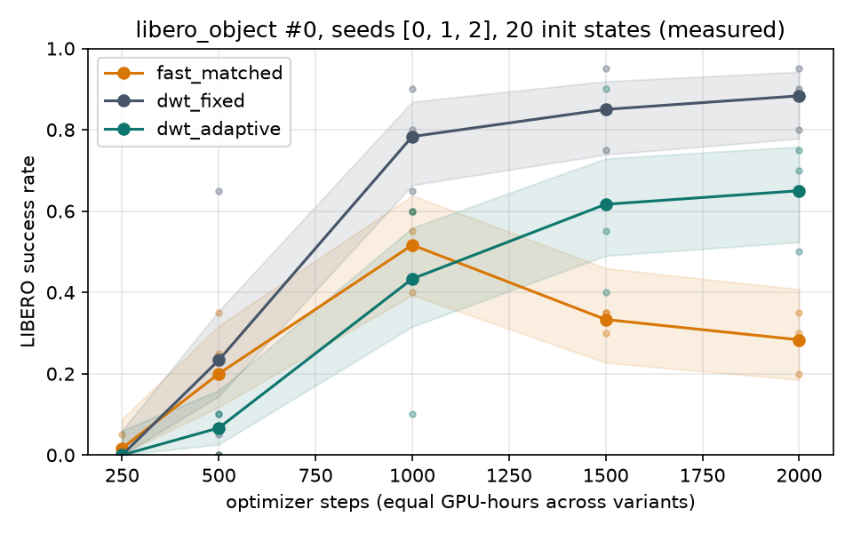

# Adaptive DWT vs FAST on π₀-FAST: experiment summary

Status labels: **measured** = produced by a run in this repo on the listed hardware; **interpolated** = linear interpolation of a measured curve; nothing here is estimated or synthetic unless it says so.

## Stage B: tiny overfit + profile (measured)

`dwt_adaptive`, 64 fixed training windows, 300 steps, micro-batch 8, lr 0.0005. Final token loss 2.26e-04, token accuracy prefix 1.000, len 1.000, res 1.000, coef 1.000, grip 1.000, eos 1.000, all 1.000. 1.65 s/step, peak reserved VRAM 41.2 GB, 0.148 GPU-h.

Constrained KV-cached generation reproduces the oracle stream exactly on 16/16 training windows (max |decoded − oracle| = 1.70e-07, mean latency 1063 ms).

## Stage C: pilot training (measured)

Task: 'pick up the alphabet soup and place it in the basket' (dataset task [24], = libero_object #0); 40 train / 4 val episodes (5840 train windows, 64 fixed val windows), H=10, effective batch 16, lr 0.0002 cosine over 5000 steps, LoRA r=16, seed 0, GPU NVIDIA RTX A6000. Base `lerobot/pi0fast-base@308eb844dabdf46cd9dcd5138c1988b7a234f1d9`.

| variant | step | trainable params | chunks seen | action tokens seen | GPU-h | s/step | peak VRAM GB | val loss | val token acc | val acc per class |
|---|---|---|---|---|---|---|---|---|---|---|
| fast_matched | 2000 | 23.81M | 32000 | 1007646 | 1.83 | 3.25 | 41.2 | 4.236 | 0.239 | prefix 1.000, fast 0.096, eos 0.984 |
| fast_matched | 5000 | 23.81M | 80000 | 2519281 | 4.57 | 3.26 | 41.3 | 5.825 | 0.224 | prefix 1.000, fast 0.079, eos 0.984 |
| dwt_fixed | 2000 | 20.85M | 32000 | 2307762 | 1.83 | 3.26 | 41.2 | 2.777 | 0.389 | prefix 1.000, len 1.000, res 1.000, coef 0.268, grip 0.958, eos 1.000 |
| dwt_fixed | 5000 | 20.85M | 80000 | 5769380 | 4.56 | 3.25 | 41.2 | 4.177 | 0.365 | prefix 1.000, len 1.000, res 1.000, coef 0.241, grip 0.925, eos 1.000 |
| dwt_adaptive | 2000 | 20.85M | 32000 | 2043196 | 1.83 | 3.26 | 41.2 | 3.068 | 0.355 | prefix 1.000, len 0.694, res 0.746, coef 0.226, grip 0.939, eos 1.000 |
| dwt_adaptive | 5000 | 20.85M | 80000 | 5108195 | 4.58 | 3.27 | 41.2 | 4.975 | 0.333 | prefix 1.000, len 0.679, res 0.731, coef 0.201, grip 0.931, eos 0.984 |

Equal-GPU-hour view (**interpolated** from measured val curves) at 4.56 GPU-h: fast_matched val loss 5.820, dwt_fixed val loss 4.177, dwt_adaptive val loss 4.960. Token losses are per-token cross-entropy over different vocabularies and stream lengths, so they compare learning progress within a variant, not tokenizer quality across variants.

## Stage D: closed-loop LIBERO (measured)

Same fixed initial states (listed per row) for every model, 256×256 renders, 10 actions executed per chunk, suite max steps. 95% Wilson intervals.

| model | task | successes | rate | 95% CI | tokens/chunk | latency ms | p95 ms | malformed chunks | masked grammar violations | init states |
|---|---|---|---|---|---|---|---|---|---|---|
| fast_matched@pilot_fast_matched:step_02000 | libero_object#0 | 9/20 | 0.45 | [0.26, 0.66] | 30.9 | 593 | 824 | 417/458 | – | 0–19 |
| dwt_fixed@pilot_dwt_fixed:step_02000 | libero_object#0 | 14/20 | 0.70 | [0.48, 0.85] | 69.1 | 1145 | 1339 | 0/367 | 10 | 0–19 |
| dwt_adaptive@pilot_dwt_adaptive:step_02000 | libero_object#0 | 16/20 | 0.80 | [0.58, 0.92] | 62.3 | 1046 | 1346 | 0/373 | 11 | 0–19 |
| ref_pi0fast_libero | libero_object#0 | 17/20 | 0.85 | [0.64, 0.95] | – | 451 | 611 | n/a | – | 0–19 |
| ref_pi0_libero | libero_object#0 | 13/20 | 0.65 | [0.43, 0.82] | – | 197 | 306 | n/a | – | 0–19 |
| fast_matched@pilot_fast_matched:step_05000 | libero_object#0 | 5/20 | 0.25 | [0.11, 0.47] | 31.2 | 595 | 871 | 460/507 | – | 0–19 |
| dwt_fixed@pilot_dwt_fixed:step_05000 | libero_object#0 | 17/20 | 0.85 | [0.64, 0.95] | 69.1 | 1137 | 1363 | 0/347 | 87 | 0–19 |
| dwt_adaptive@pilot_dwt_adaptive:step_05000 | libero_object#0 | 13/20 | 0.65 | [0.43, 0.82] | 63.4 | 1061 | 1328 | 0/412 | 151 | 0–19 |
| full40_dwt_fixed_slw@full_s0_dwt_fixed_slw:step_14500 | libero_object#0 | 4/10 | 0.40 | [0.17, 0.69] | 69.1 | 1109 | 1289 | 0/263 | – | 0–9 |
| full40_dwt_fixed_slw@full_s0_dwt_fixed_slw:step_43500 | libero_object#0 | 8/10 | 0.80 | [0.49, 0.94] | 69.1 | 1126 | 1290 | 0/207 | – | 0–9 |
| full40_ref_pi0fast_libero | libero_object#0 | 10/10 | 1.00 | [0.72, 1.00] | – | 429 | 551 | n/a | – | 0–9 |
| full40_dwt_fixed_lw@full_e4_dwt_fixed_lw:step_58000 | libero_object#0 | 6/10 | 0.60 | [0.31, 0.83] | 69.1 | 1177 | 1519 | 0/231 | – | 0–9 |
| full40_dwt_fixed_slw@full_e4_dwt_fixed_slw:step_58000 | libero_object#0 | 7/10 | 0.70 | [0.40, 0.89] | 69.1 | 1173 | 1504 | 0/197 | – | 0–9 |
| full40_dwt_fixed@full_e4_dwt_fixed:step_58000 | libero_object#0 | 5/10 | 0.50 | [0.24, 0.76] | 69.1 | 1107 | 1261 | 0/232 | – | 0–9 |
| full40_dwt_fixed_slw@full_s0_dwt_fixed_slw:step_29000 | libero_object#0 | 5/10 | 0.50 | [0.24, 0.76] | 69.1 | 1099 | 1267 | 0/234 | – | 0–9 |
| full40_dct_fixed@full_s0_dct_fixed:step_14500 | libero_object#0 | 10/10 | 1.00 | [0.72, 1.00] | 64.1 | 1002 | 1101 | 0/150 | – | 0–9 |
| full40_dct_fixed@full_s0_dct_fixed:step_29000 | libero_object#0 | 9/10 | 0.90 | [0.60, 0.98] | 64.1 | 1020 | 1134 | 0/159 | – | 0–9 |
| full40_dwt_fixed@full_s0_dwt_fixed:step_14500 | libero_object#0 | 10/10 | 1.00 | [0.72, 1.00] | 69.1 | 1092 | 1250 | 0/172 | – | 0–9 |
| full40_dwt_fixed@full_s0_dwt_fixed:step_29000 | libero_object#0 | 10/10 | 1.00 | [0.72, 1.00] | 69.1 | 1096 | 1278 | 0/160 | – | 0–9 |
| full40_dct_fixed@full_e3_dct_fixed_sqrtw:step_43500 | libero_object#0 | 10/10 | 1.00 | [0.72, 1.00] | 64.1 | 1044 | 1243 | 0/142 | – | 0–9 |
| full40_dct_fixed@full_s0_dct_fixed:step_43500 | libero_object#0 | 10/10 | 1.00 | [0.72, 1.00] | 64.1 | 1031 | 1206 | 0/140 | – | 0–9 |
| full40_dct_fixed@full_s0_dct_fixed_sqrtw:step_14500 | libero_object#0 | 8/10 | 0.80 | [0.49, 0.94] | 64.1 | 1017 | 1162 | 0/197 | – | 0–9 |
| full40_dct_fixed@full_e4_dct_fixed_bw5:step_58000 | libero_object#0 | 10/10 | 1.00 | [0.72, 1.00] | 64.1 | 1028 | 1222 | 0/155 | – | 0–9 |

*Malformed chunks*: for `fast_matched`, generated streams without `|` or whose BPE decode is not exactly 70 DCT coefficients; they are executed after upstream's relaxed decode (zero-pad / truncate), exactly as stock π₀-FAST does. For the DWT variants, streams the grammar parser rejects (replaced by the safe fallback chunk); the constrained decoder makes these impossible by construction. *Masked grammar violations*: generated positions where the unconstrained argmax was an illegal token and the FSM mask changed the choice. Not available for `ref_*` (stock decoder).

`ref_*` rows are the unmodified LeRobot checkpoints fine-tuned on all of LIBERO (all 40 tasks, full fine-tune, far more compute); they bound what the pilot recipe could reach and are not a matched comparison.

## Learning curve: closed-loop success vs training step (measured)

Separate runs `lc_s<seed>_<variant>` (seeds [0, 1, 2]), same recipe as the pilot (5k-step cosine schedule stopped at 2k), adapter checkpoints evaluated on init states 0–19. Cells: successes/20 per seed; pooled = all seeds with a 95% Wilson interval. GPU-hours per step are equal across variants (3.26 s/step measured), so the step axis is also an equal-compute axis.

| variant | step | seed 0 | seed 1 | seed 2 | pooled | 95% CI | malformed chunks |
|---|---|---|---|---|---|---|---|
| fast_matched | 250 | 0/20 | 1/20 | 0/20 | 1/60 = 0.02 | [0.00, 0.09] | 98% |
| fast_matched | 500 | 5/20 | 0/20 | 7/20 | 12/60 = 0.20 | [0.12, 0.32] | 98% |
| fast_matched | 1000 | 11/20 | 8/20 | 12/20 | 31/60 = 0.52 | [0.39, 0.64] | 91% |
| fast_matched | 1500 | 7/20 | 6/20 | 7/20 | 20/60 = 0.33 | [0.23, 0.46] | 90% |
| fast_matched | 2000 | 4/20 | 6/20 | 7/20 | 17/60 = 0.28 | [0.19, 0.41] | 89% |
| dwt_fixed | 250 | 0/20 | 0/20 | 0/20 | 0/60 = 0.00 | [0.00, 0.06] | 0% |
| dwt_fixed | 500 | 13/20 | 0/20 | 1/20 | 14/60 = 0.23 | [0.14, 0.35] | 0% |
| dwt_fixed | 1000 | 16/20 | 18/20 | 13/20 | 47/60 = 0.78 | [0.66, 0.87] | 0% |
| dwt_fixed | 1500 | 15/20 | 17/20 | 19/20 | 51/60 = 0.85 | [0.74, 0.92] | 0% |
| dwt_fixed | 2000 | 16/20 | 18/20 | 19/20 | 53/60 = 0.88 | [0.78, 0.94] | 0% |
| dwt_adaptive | 250 | 0/20 | 0/20 | 0/20 | 0/60 = 0.00 | [0.00, 0.06] | 0% |
| dwt_adaptive | 500 | 2/20 | 2/20 | 0/20 | 4/60 = 0.07 | [0.03, 0.16] | 0% |
| dwt_adaptive | 1000 | 12/20 | 2/20 | 12/20 | 26/60 = 0.43 | [0.32, 0.56] | 0% |
| dwt_adaptive | 1500 | 8/20 | 11/20 | 18/20 | 37/60 = 0.62 | [0.49, 0.73] | 0% |
| dwt_adaptive | 2000 | 10/20 | 14/20 | 15/20 | 39/60 = 0.65 | [0.52, 0.76] | 0% |

Paired against `fast_matched` at the same step, seed and initial state (exact McNemar):

| variant | step | pairs | only DWT succeeds | only FAST succeeds | p |
|---|---|---|---|---|---|
| dwt_fixed | 250 | 60 | 0 | 1 | 1.000 |
| dwt_fixed | 500 | 60 | 10 | 8 | 0.815 |
| dwt_fixed | 1000 | 60 | 21 | 5 | 0.002 |
| dwt_fixed | 1500 | 60 | 33 | 2 | 0.000 |
| dwt_fixed | 2000 | 60 | 37 | 1 | 0.000 |
| dwt_adaptive | 250 | 60 | 0 | 1 | 1.000 |
| dwt_adaptive | 500 | 60 | 3 | 11 | 0.057 |
| dwt_adaptive | 1000 | 60 | 13 | 18 | 0.473 |
| dwt_adaptive | 1500 | 60 | 27 | 10 | 0.008 |
| dwt_adaptive | 2000 | 60 | 26 | 4 | 0.000 |

Paired comparison on identical initial states (exact two-sided McNemar test on discordant pairs):

| model A | model B | pairs | both succeed | only A | only B | both fail | p |
|---|---|---|---|---|---|---|---|
| dwt_fixed@pilot_dwt_fixed:step_02000 | fast_matched@pilot_fast_matched:step_02000 | 20 | 7 | 7 | 2 | 4 | 0.180 |
| dwt_adaptive@pilot_dwt_adaptive:step_02000 | fast_matched@pilot_fast_matched:step_02000 | 20 | 8 | 8 | 1 | 3 | 0.039 |
| dwt_fixed@pilot_dwt_fixed:step_05000 | fast_matched@pilot_fast_matched:step_05000 | 20 | 4 | 13 | 1 | 2 | 0.002 |
| dwt_adaptive@pilot_dwt_adaptive:step_05000 | fast_matched@pilot_fast_matched:step_05000 | 20 | 2 | 11 | 3 | 4 | 0.057 |

## Caveats (read before citing any number above)

- One task, one training seed, 20 rollouts per model: a pilot. Intervals are wide and the paired tests are not corrected for multiple comparisons.
- `fast_matched` starts from π₀-FAST-base, whose FAST vocabulary was pretrained on other embodiments, and learns LIBERO FAST tokens with the same LoRA/adapter budget as the DWT variants. Its validation FAST-token accuracy stays low and most of its generated streams are malformed, so part of the gap may be adaptation difficulty of BPE tokens under this recipe rather than an intrinsic property of DCT tokens. The full fine-tune `ref_pi0fast_libero` shows FAST itself can reach high success on this task.
- DWT streams are ~2× longer than FAST streams, so per-chunk inference latency roughly doubles with the same KV-cached decoder.
- Validation token loss rises after ~1k steps for every variant (40 training episodes): the models memorize the training demonstrations. Token loss on held-out episodes does not track closed-loop success, and the 2k → 5k success changes per variant are themselves within 20-episode noise.

